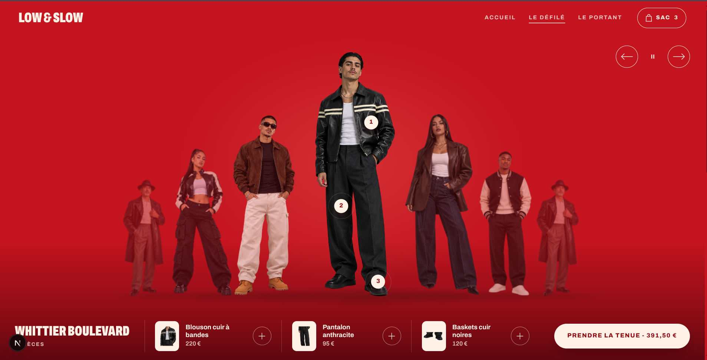

# Low & Slow - Chicano Lowrider Streetwear Lookbook

A **bold, immersive shopping experience** built with Next.js, Tailwind CSS, and TypeScript, featuring a single "red room" aesthetic, choreographed motion design, and a try-the-look architecture.

---

## Features

- Runway line-up where six full-body looks stand on one floor and slide into the centre with drag, arrows, horizontal wheel, keyboard, or autoplay
- Numbered pins placed on each garment, with name and price tooltips, linked to the matching piece on the shelf below
- Zoomed look view with a full-height model and a side recap of the outfit, opening and closing through a shared-position flight animation
- Size picker sheet on every piece and a one-tap full-outfit bundle at -10 %, priced in euros
- Clothing rail with hanger physics for the six jackets and coats, brushed with the pointer or swiped on touch screens
- Rail detail view that flips the garment on hover, shows the model wearing it, and completes the outfit with the two other pieces
- Local shopping bag saved in the browser, with toast feedback and a downloadable text shortlist (no checkout or payment)
- Responsive French interface with reduced-motion support, keyboard navigation, and a custom brand icon

---

## Technologies Used

- **Next.js 16 (App Router)** - React framework with Turbopack and static generation
- **React 19** - Component-based UI architecture and modern React hooks
- **TypeScript** - Strongly typed JavaScript for robust scalability and maintainable development
- **Tailwind CSS v4 + tw-animate-css** - Utility-first styling with design tokens in `globals.css` and a dedicated theme layer
- **GSAP + Motion** - Runway choreography, flight transitions, dialog and toast animations
- **CSS 3D transforms + SVG** - Perspective garment flips, drawn hangers, and a spring-based rail simulation
- **Custom Google Fonts** - Archivo, self-hosted and variable in weight and width (Display and Body)

---

## Preview

